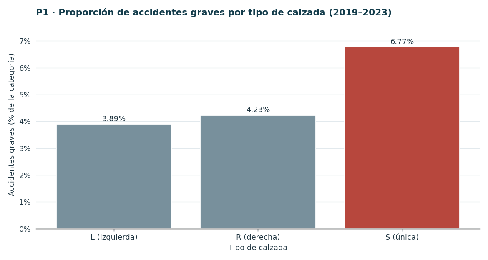
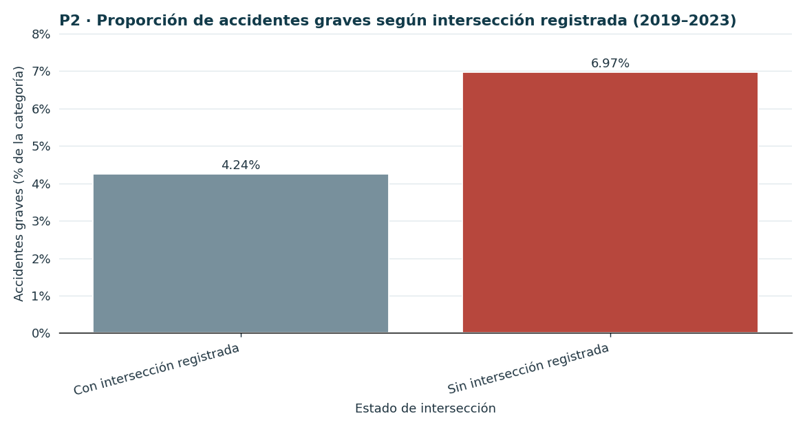
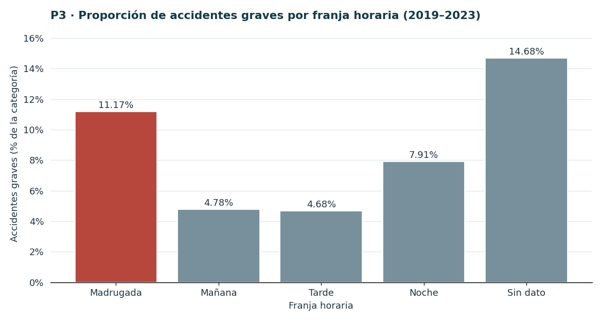
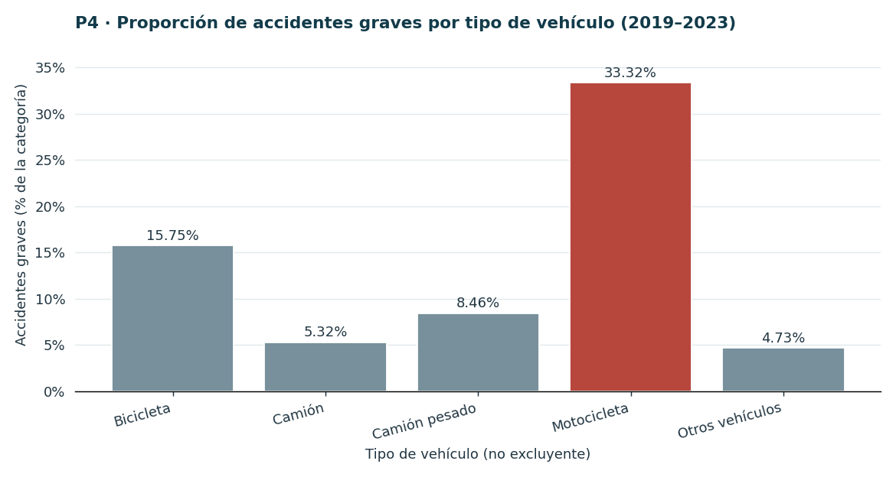
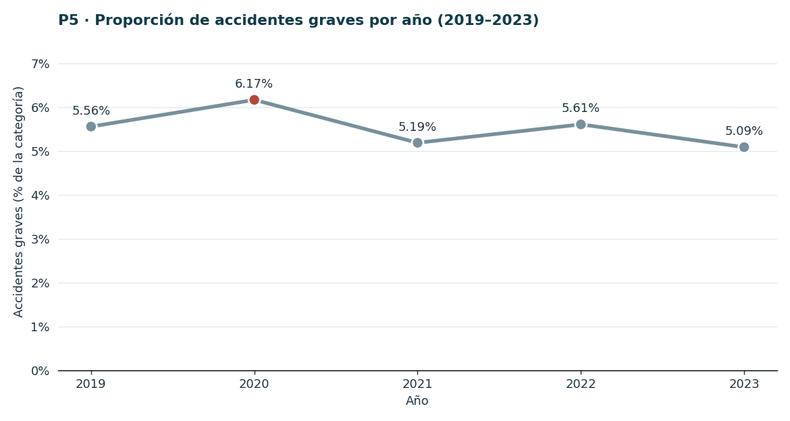
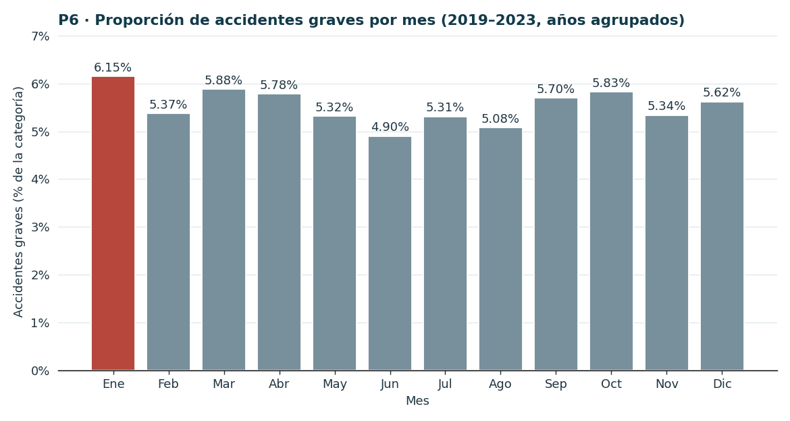
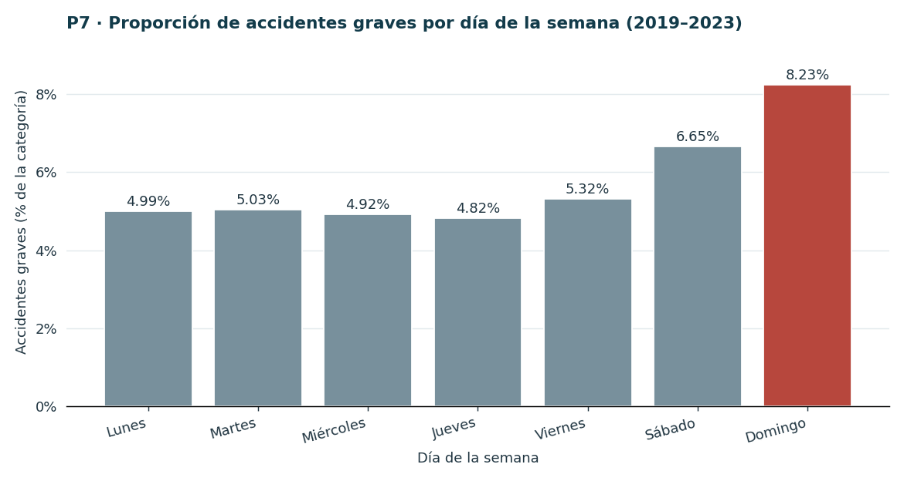
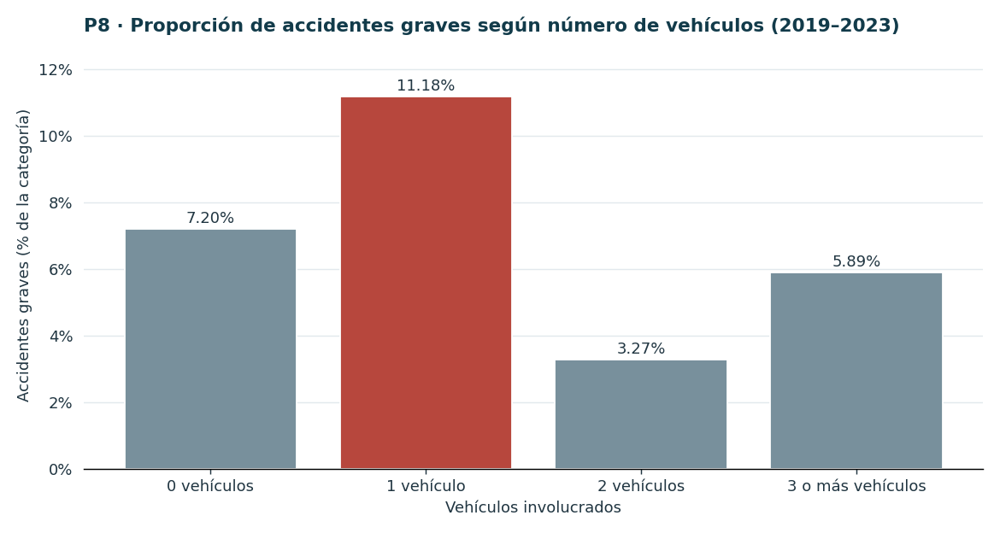

# Severidad de accidentes de tránsito en Australia Occidental (2019–2023)

Proyecto Integrador III de Analítica de Datos, Institución Universitaria Digital de Antioquia.

Este README documenta la actividad **AE3: Transformación y enriquecimiento de datos**. Para AE2 (ideación y documentación de la necesidad) véase `AE2/`. También documenta **AE4: métricas y visualización**, la presentación en Streamlit de las ocho preguntas de negocio.

**Aplicación publicada:** https://pi2026iud-6kblhuwj7qk48u4pnacwyj.streamlit.app/

## Integrantes

- Juan Felipe Valencia Renteria
- Cristian Mateo Piedrahita Arango
- Diego Alejandro Barros Ballestas

## Propósito y necesidad

Las entidades de seguridad vial tienen un registro extenso de accidentes, pero no una lectura que relacione la gravedad con las condiciones en que ocurren. Un conteo total no distingue entre una categoría con muchos accidentes leves y otra con pocos accidentes fatales.

**Pregunta principal:** ¿cómo se distribuye la severidad (`SEVERITY`) de los accidentes registrados entre 2019 y 2023 según el tipo de calzada, la presencia de intersección, la franja horaria y los tipos de vehículos involucrados?

El alcance es descriptivo: no hay modelos predictivos, causas ni tasas de riesgo, porque el dataset no incluye datos de exposición (volumen de tránsito).

## AE4: métricas y visualización

La aplicación presenta las ocho preguntas de negocio con métricas, gráficos
interactivos y una interpretación descriptiva. Para ejecutarla desde la raíz del
repositorio:

```bash
python -m pip install -r requirements.txt
streamlit run AE4/app.py
```

La app lee únicamente las tablas de `AE3/resultados/tabla_*.csv`; no necesita
cargar `WA_Crash_enriquecido.csv`. Las rutas se construyen desde `AE4/app.py`
para permitir la ejecución local y en Streamlit Community Cloud. La aplicación
está publicada aquí: **https://pi2026iud-6kblhuwj7qk48u4pnacwyj.streamlit.app/**

### Contexto de la presentación

La presentación es una aplicación de Streamlit que responde las ocho preguntas de negocio con métricas, gráficos interactivos y una interpretación descriptiva. Está publicada en https://pi2026iud-6kblhuwj7qk48u4pnacwyj.streamlit.app/

**Estructura de la aplicación.** Un menú lateral permite ir a cada sección:

| Sección | Contenido |
|---|---|
| Inicio | Necesidad, pregunta principal, métricas generales (127.102 accidentes, 6.999 graves, 5,51 %), distribución por severidad y alcance |
| P1 · Calzada a P8 · Número de vehículos | Una sección por pregunta de negocio |
| Conclusiones y límites | Conclusiones, recomendaciones y limitaciones generales |

Cada sección de pregunta (P1 a P8) muestra tres métricas (la proporción grave más alta, y los accidentes y accidentes graves de esa categoría) y tres pestañas: **Gráfico**, **Interpretación** y **Limitaciones**.

**Métrica principal.** Proporción de accidentes graves = (Fatal + Hospital) ÷ accidentes de la categoría × 100. Se expresa como porcentaje de los accidentes de esa categoría; los conteos se muestran como número de accidentes. En los gráficos, la barra (o punto) roja marca la categoría con la proporción más alta.

**Alcance.** El análisis es descriptivo: no estima causas, predicciones ni tasas de riesgo.

## Resultados por pregunta de negocio

Cada pregunta se presenta con su gráfico, los datos de la tabla de resultados correspondiente, un análisis y una interpretación, como en la aplicación. Los gráficos de esta sección usan las mismas tablas `AE3/resultados/tabla_*.csv` que la aplicación; se guardan en `AE4/graficos/`.

### P1 · Calzada

**Pregunta:** ¿Cómo se distribuye la severidad según el tipo de calzada (`CWAY`)?

**Gráfico**



| Categoría | Accidentes (n) | Graves (n) | Graves (%) |
|---|---:|---:|---:|
| L (izquierda) | 44.758 | 1.741 | 3,89 |
| R (derecha) | 12.390 | 524 | 4,23 |
| S (única) | 69.954 | 4.734 | 6,77 |

**Análisis**

La calzada única (S) concentra el 55,04 % de los accidentes y el 67,64 % de los graves (4.734 de 6.999). Su proporción grave es 6,77 %, frente a 3,89 % en la izquierda (L) y 4,23 % en la derecha (R). La proporción de fatales también es mayor en S (0,85 %) que en L (0,21 %) y R (0,33 %).

**Interpretación**

La calzada única registra la mayor proporción de accidentes graves. Esto permite priorizar una revisión descriptiva de los segmentos por tipo de calzada, sin atribuirles causalidad.

**Limitaciones**

Los códigos S, L y R describen el tipo de calzada, no las condiciones completas del tramo ni la exposición al tránsito.

### P2 · Intersección

**Pregunta:** ¿Cambia la severidad entre accidentes con y sin intersección registrada?

**Gráfico**



| Categoría | Accidentes (n) | Graves (n) | Graves (%) |
|---|---:|---:|---:|
| Con intersección registrada | 68.123 | 2.887 | 4,24 |
| Sin intersección registrada | 58.979 | 4.112 | 6,97 |

**Análisis**

Con intersección registrada la proporción grave es 4,24 %; sin intersección registrada es 6,97 %. El grupo sin intersección registrada reúne el 46,40 % de los accidentes y el 58,75 % de los graves (4.112). Su proporción de fatales también es mayor (0,99 % frente a 0,23 %).

**Interpretación**

La diferencia sugiere revisar la calidad y completitud del registro de intersecciones antes de orientar análisis posteriores.

**Limitaciones**

“Sin intersección registrada” significa que falta el dato; no confirma que el accidente ocurriera fuera de una intersección. La variable `ESTADO_INTERSECCION` coincide con `ACCIDENT_TYPE` en 127.083 de 127.102 registros (99,99 %).

### P3 · Franja horaria

**Pregunta:** ¿En qué franja horaria se concentran los accidentes graves?

**Gráfico**



| Categoría | Accidentes (n) | Graves (n) | Graves (%) |
|---|---:|---:|---:|
| Madrugada | 5.355 | 598 | 11,17 |
| Mañana | 41.208 | 1.968 | 4,78 |
| Tarde | 60.278 | 2.822 | 4,68 |
| Noche | 20.152 | 1.595 | 7,91 |
| Sin dato | 109 | 16 | 14,68 |

*En el gráfico, la barra roja marca la franja con la mayor proporción entre las que tienen hora conocida; “Sin dato” permanece visible pero no se destaca.*

**Análisis**

La tarde reúne el mayor número de accidentes graves (2.822, el 40,32 % de los graves) porque concentra el 47,42 % de los accidentes, pero su proporción es la menor entre las franjas con hora conocida (4,68 %). La madrugada tiene la mayor proporción (11,17 %) con solo 5.355 accidentes, y la noche llega a 7,91 %. “Sin dato” marca 14,68 %, pero corresponde solo a 109 registros.

**Interpretación**

Volumen y proporción responden preguntas distintas: donde hay más accidentes graves en número no es donde un accidente tiene más probabilidad de ser grave.

**Limitaciones**

Hay 109 registros sin hora (0,09 %), por eso “Sin dato” no se destaca. La comparación no incluye volumen de tránsito por hora y no permite inferir riesgo.

### P4 · Tipo de vehículo

**Pregunta:** ¿Qué tipos de vehículos participan y con qué severidad?

**Gráfico**



| Categoría | Accidentes (n) | Graves (n) | Graves (%) |
|---|---:|---:|---:|
| Bicicleta | 2.539 | 400 | 15,75 |
| Camión | 4.530 | 241 | 5,32 |
| Camión pesado | 2.318 | 196 | 8,46 |
| Motocicleta | 4.334 | 1.444 | 33,32 |
| Otros vehículos | 118.208 | 5.596 | 4,73 |

**Análisis**

La motocicleta tiene la mayor proporción grave (33,32 %): participa en el 3,41 % de los accidentes, pero en el 20,63 % de los graves (1.444). Le siguen la bicicleta (15,75 %) y el camión pesado (8,46 %). “Otros vehículos” agrupa el 93,00 % de los accidentes y tiene 4,73 %.

**Interpretación**

La motocicleta y la bicicleta muestran las proporciones graves más altas. Esta comparación puede orientar preguntas de seguimiento por tipo de vehículo, no conclusiones sobre causas.

**Limitaciones**

Las categorías no son excluyentes: un accidente puede aparecer en más de un tipo. “Otros vehículos” agrupa muchos registros sin detalle. La fila de referencia (todos los accidentes) se omite del gráfico.

### P5 · Año

**Pregunta:** ¿La proporción de accidentes graves cambió entre 2019 y 2023?

**Gráfico**



| Categoría | Accidentes (n) | Graves (n) | Graves (%) |
|---|---:|---:|---:|
| 2019 | 26.685 | 1.484 | 5,56 |
| 2020 | 22.975 | 1.418 | 6,17 |
| 2021 | 26.566 | 1.378 | 5,19 |
| 2022 | 25.057 | 1.405 | 5,61 |
| 2023 | 25.819 | 1.314 | 5,09 |

**Análisis**

La proporción anual varía entre 5,09 % (2023) y 6,17 % (2020). 2020 fue el año con menos accidentes (22.975) y con la mayor proporción grave. Los graves en número bajan de 1.484 (2019) a 1.314 (2023), con oscilaciones intermedias.

**Interpretación**

No hay una tendencia sostenida de aumento o disminución en el periodo. La serie sirve para definir qué cambios conviene estudiar con más contexto.

**Limitaciones**

Son proporciones descriptivas anuales; no se evaluó significancia estadística ni se controlaron cambios en exposición o registro.

### P6 · Mes

**Pregunta:** ¿Hay meses con mayor proporción de accidentes graves?

**Gráfico**



| Categoría | Accidentes (n) | Graves (n) | Graves (%) |
|---|---:|---:|---:|
| Enero | 9.152 | 563 | 6,15 |
| Febrero | 10.363 | 557 | 5,37 |
| Marzo | 10.978 | 646 | 5,88 |
| Abril | 8.802 | 509 | 5,78 |
| Mayo | 11.094 | 590 | 5,32 |
| Junio | 11.128 | 545 | 4,9 |
| Julio | 11.119 | 590 | 5,31 |
| Agosto | 11.557 | 587 | 5,08 |
| Septiembre | 10.467 | 597 | 5,7 |
| Octubre | 10.877 | 634 | 5,83 |
| Noviembre | 10.964 | 585 | 5,34 |
| Diciembre | 10.601 | 596 | 5,62 |

**Análisis**

Enero tiene la mayor proporción (6,15 %) y junio la menor (4,90 %): una diferencia de 1,25 puntos porcentuales. Los demás meses se mueven entre 5,08 % y 5,88 %.

**Interpretación**

La diferencia puede señalar meses para una revisión más detallada, pero no demuestra un patrón estacional ni explica sus motivos.

**Limitaciones**

Cada punto agrupa todos los años. No se comparan años por separado ni se consideran exposición, cambios de población o variaciones de registro.

### P7 · Día de la semana

**Pregunta:** ¿Son más graves los accidentes en fin de semana?

**Gráfico**



| Categoría | Accidentes (n) | Graves (n) | Graves (%) |
|---|---:|---:|---:|
| Lunes | 17.663 | 882 | 4,99 |
| Martes | 20.213 | 1.017 | 5,03 |
| Miércoles | 19.914 | 980 | 4,92 |
| Jueves | 20.689 | 997 | 4,82 |
| Viernes | 21.956 | 1.169 | 5,32 |
| Sábado | 15.262 | 1.015 | 6,65 |
| Domingo | 11.405 | 939 | 8,23 |

**Análisis**

El domingo presenta la mayor proporción (8,23 %), seguido del sábado (6,65 %); de lunes a viernes oscila entre 4,82 % y 5,32 %. Al agrupar, el fin de semana alcanza 7,33 % (1.954 graves de 26.667 accidentes) y lunes a viernes 5,02 % (5.045 de 100.435). El domingo es además el día con menos accidentes (11.405), pero con la mayor proporción de fatales (1,10 %).

**Interpretación**

Es un contraste descriptivo que puede orientar preguntas de seguimiento sobre el fin de semana.

**Limitaciones**

La comparación agrupa días de todos los años y no tiene denominadores de exposición; no permite afirmar que el fin de semana cause mayor gravedad.

### P8 · Número de vehículos

**Pregunta:** ¿Aumenta la gravedad cuando participan más vehículos?

**Gráfico**



| Categoría | Accidentes (n) | Graves (n) | Graves (%) |
|---|---:|---:|---:|
| 0 vehículos | 5.292 | 381 | 7,2 |
| 1 vehículo | 31.178 | 3.487 | 11,18 |
| 2 vehículos | 84.111 | 2.747 | 3,27 |
| 3 o más vehículos | 6.521 | 384 | 5,89 |

**Análisis**

La mayor proporción grave corresponde a accidentes con 1 vehículo (11,18 %), que reúnen el 49,82 % de los graves (3.487). Con 2 vehículos baja a 3,27 % (aunque son el 66,18 % de los accidentes) y con 3 o más sube a 5,89 %. Los de 0 vehículos tienen 7,20 %.

**Interpretación**

La relación no aumenta de forma monotónica: más vehículos no equivale a una mayor proporción grave en estos datos.

**Limitaciones**

El conteo `TOTAL_VEHICULOS_INVOLUCRADOS` suma bicicletas, camiones, camiones pesados, motocicletas y otros vehículos, y no incluye peatones; por eso la categoría de 0 vehículos agrupa accidentes sin ninguno de esos vehículos registrados.


## Tablas de resultados

Distribución general: Fatal 735 (0,58 %), Hospital 6.264 (4,93 %), Medical 16.485 (12,97 %), PDO Major 68.868 (54,18 %), PDO Minor 34.750 (27,34 %). **Graves (Fatal + Hospital): 6.999 (5,51 %).**

Proporción de accidentes graves por categoría (fuente: `AE3/resultados/tabla_*.csv`):

| Pregunta | Categoría | Accidentes (n) | Graves (%) |
|---|---|---:|---:|
| P1 Calzada | S (única) | 69.954 | 6,77 |
| | L (izquierda) | 44.758 | 3,89 |
| | R (derecha) | 12.390 | 4,23 |
| P2 Intersección | Con intersección registrada | 68.123 | 4,24 |
| | Sin intersección registrada | 58.979 | 6,97 |
| P3 Franja horaria | Madrugada | 5.355 | 11,17 |
| | Mañana | 41.208 | 4,78 |
| | Tarde | 60.278 | 4,68 |
| | Noche | 20.152 | 7,91 |
| | Sin dato | 109 | 14,68 |
| P4 Vehículo (no excluyentes) | Motocicleta | 4.334 | 33,32 |
| | Bicicleta | 2.539 | 15,75 |
| | Camión pesado | 2.318 | 8,46 |
| | Camión | 4.530 | 5,32 |
| | Otros vehículos | 118.208 | 4,73 |
| P5 Año | 2019 / 2020 / 2021 / 2022 / 2023 | 26.685 / 22.975 / 26.566 / 25.057 / 25.819 | 5,56 / 6,17 / 5,19 / 5,61 / 5,09 |
| P6 Mes | Enero (máx.) / Junio (mín.) | 9.152 / 11.128 | 6,15 / 4,90 |
| P7 Día | Domingo / Sábado / Lunes a viernes | 11.405 / 15.262 / 100.435 | 8,23 / 6,65 / 4,82–5,32 |
| P8 Total de vehículos | 0 / 1 / 2 / 3 o más | 5.292 / 31.178 / 84.111 / 6.521 | 7,20 / 11,18 / 3,27 / 5,89 |

Lectura breve:

- La gravedad no se reparte de forma homogénea: sube con motocicletas y bicicletas, en la madrugada y la noche, en calzada única, en tramos y en fines de semana.
- Volumen y gravedad no coinciden: la tarde concentra el 47,42 % de los accidentes pero tiene la menor proporción de graves.
- La gravedad no aumenta con más vehículos: el máximo está en los accidentes de un solo vehículo.

## Limitaciones

- Sin datos de exposición no se puede hablar de riesgo, solo de distribución de accidentes registrados.
- "Sin intersección registrada" es un dato faltante y no una verificación en terreno.
- Los tipos de vehículo no son excluyentes; "Otros vehículos" agrupa el 93 % de los accidentes sin detalle.
- La severidad proviene del registro policial y puede subestimar la gravedad de motociclistas, peatones y ciclistas.
- 109 registros no tienen hora (0,09 %).
- Las comparaciones son descriptivas: no se aplicaron pruebas estadísticas.

## Conclusiones y recomendaciones

**Conclusiones**

- Entre 2019 y 2023 se registraron 127.102 accidentes y 6.999 graves (5,51 %).
- Volumen y proporción de gravedad no son lo mismo: la tarde concentra el 47,42 % de los accidentes, pero tiene la menor proporción grave entre las franjas con dato (4,68 %).
- Las proporciones más altas aparecen en motocicleta (33,32 %), madrugada (11,17 %), accidentes de un solo vehículo (11,18 %), domingo (8,23 %), accidentes sin intersección registrada (6,97 %) y calzada única (6,77 %). Son comparaciones descriptivas, no explicaciones.
- No se observa una tendencia sostenida por año (P5), y la diferencia entre meses es pequeña (P6).

**Recomendaciones**

- Priorizar la revisión de calidad y completitud de variables como intersección y hora.
- Usar estas diferencias para formular análisis posteriores, incorporando datos de exposición al tránsito antes de hablar de tasas o riesgo.
- Presentar juntos conteos y proporciones para no confundir volumen con gravedad.

Las limitaciones generales están en la sección **Limitaciones**.

## Estructura del repositorio

```text
PI_2026_IUD/
├── .github/
│   └── workflows/
│       ├── ejecucion-automatica.yml     # ejecución automática de AE2
│       └── ejecutar-ae3.yml             # ejecución automática de AE3
├── AE2/                                 # ideación y documentación de la necesidad
│   ├── documento/
│   ├── notebooks/Semana_1SINC.ipynb
│   ├── resultados/
│   └── src/clases_po/
├── AE3/                                 # transformación y enriquecimiento
│   ├── documento/                       # (propuesto) informe Word de avance
│   ├── notebooks/
│   │   └── AE3_Transformacion_Enriquecimiento.ipynb
│   ├── resultados/                      # dataset preparado, tablas y reportes
│   └── src/clases_po/
│       ├── hf_loader.py                 # HFDatasetLoader (descarga desde Hugging Face)
│       ├── preprocesamiento.py          # PreprocesadorCrash
│       ├── enriquecimiento.py           # Enriquecimiento
│       ├── reportes.py                  # Reportes descriptivos
│       └── llm_nvidia.py                # ClienteNvidia (verificación de lectura)
├── AE4/                                 # presentación en Streamlit
│   ├── app.py                           # aplicación (métricas, gráficos e interpretación)
│   └── graficos/                        # gráficos P1 a P8 usados en este README
├── .gitignore
├── Informe_proyecto_integrado_III.pdf   # informe del proyecto integrado III
├── README.md
└── requirements.txt
```

## EA3: Transaformación y Enriquecimiento

## Dataset

| Característica | Detalle |
|---|---|
| Identificador | `kalley/WA_Crash` (split `train`) |
| Enlace | https://huggingface.co/datasets/kalley/WA_Crash |
| Tamaño original | 127.102 filas × 26 columnas |
| Origen declarado | Main Roads Western Australia (Data WA) |
| Acceso | Público; no requiere token |

El dataset crudo **no se versiona**: `HFDatasetLoader` lo descarga de Hugging Face en cada ejecución (`.gitignore` excluye `**/WA_Crash.csv`).

## Transformaciones realizadas

El procesamiento está en la clase `PreprocesadorCrash` (`AE3/src/clases_po/preprocesamiento.py`).

| Paso | Regla | Resultado |
|---|---|---|
| Conversión de fecha | `CRASH_DATE` (texto día/mes/año) a fecha | 0 no interpretables |
| Conversión de hora | `CRASH_TIME` (HHMM) a `Int64`; válida si está entre 0000 y 2359 y minutos < 60 | 0 inválidas; los 109 nulos de origen se conservan |
| Conversión de conteos | Columnas `TOTAL_*_INVOLVED` a `Int64`; negativos y no enteros pasan a nulo | 0 afectados |
| Texto | Recorte de espacios al inicio y al final | 0 afectados |
| Filtro de periodo | Conservar 01/01/2019 a 31/12/2023 | 0 excluidos |
| Duplicados | Completos y por `ACC_ID` | 0 |
| Categorías | Variantes de `SEVERITY` y `CWAY`; valores esperados de `SEVERITY` | 0 variantes; 5 categorías esperadas |
| Intersección | Revisar faltantes de `INTERSECTION_NO` e `INTERSECTION_DESC` | 58.979 con ambos nulos; se conservan, no se imputan |
| Selección de columnas | Descartar `X`, `Y`, `ROAD_NO`, `ROAD_NAME`, `COMMON_ROAD_NAME`, `SLK`, `OBJECTID`, `GlobalID` | 26 → 18 columnas |

Resultado: **127.102 filas antes y después** (sin exclusiones). Cinco controles de validación se cumplen: fechas en el periodo, `ACC_ID` único, tipos esperados, horas válidas y categorías de `SEVERITY` esperadas.

## Enriquecimiento realizado

No se une ninguna tabla externa (no hay uniones que multipliquen registros). La clase `Enriquecimiento` (`AE3/src/clases_po/enriquecimiento.py`) agrega 8 variables derivadas (18 → 26 columnas):

| Variable | Regla |
|---|---|
| `ANIO` | Año de `CRASH_DATE` |
| `MES` | Mes de `CRASH_DATE` (1 a 12) |
| `DIA_SEMANA` | Lunes a Domingo |
| `ES_FIN_DE_SEMANA` | 1 si es sábado o domingo; 0 en otro caso |
| `FRANJA_HORARIA` | `CRASH_TIME // 100`: Madrugada 00–05, Mañana 06–11, Tarde 12–17, Noche 18–23; `Sin dato` si es nula |
| `ESTADO_INTERSECCION` | "Con intersección registrada" si `INTERSECTION_NO` o `INTERSECTION_DESC` no son nulos; en otro caso "Sin intersección registrada" |
| `TOTAL_VEHICULOS_INVOLUCRADOS` | Suma de bicicletas, camiones, camiones pesados, motocicletas y otros vehículos (sin peatones) |
| `ES_GRAVE` | 1 si `SEVERITY` es Fatal u Hospital; 0 en otro caso |

Contraste de `ESTADO_INTERSECCION` con `ACCIDENT_TYPE`: coinciden 127.083 de 127.102 registros (99,99 %); los 19 restantes se conservan sin corregir.

## Preguntas de negocio abordadas

| Id | Pregunta | Tabla |
|---|---|---|
| P1 | ¿Cómo se distribuye la severidad según el tipo de calzada (`CWAY`)? | `tabla_calzada` |
| P2 | ¿Cambia la severidad entre accidentes con y sin intersección registrada? | `tabla_interseccion` |
| P3 | ¿En qué franja horaria se concentran los accidentes graves? | `tabla_franja_horaria` |
| P4 | ¿Qué tipos de vehículos participan y con qué severidad? | `tabla_tipo_vehiculo` |
| P5 | ¿La proporción de accidentes graves cambió entre 2019 y 2023? | `tabla_anio` |
| P6 | ¿Hay meses con mayor proporción de accidentes graves? | `tabla_mes` |
| P7 | ¿Son más graves los accidentes en fin de semana? | `tabla_dia_semana` |
| P8 | ¿Aumenta la gravedad cuando participan más vehículos? | `tabla_total_vehiculos` |

P1 a P4 responden la pregunta principal; P5 a P8 la amplían con las variables derivadas.

## Pasos de ejecución

Requisitos: Python 3.11, Git y conexión a internet.

```bash
git clone https://github.com/juanrenteria-ai/PI_2026_IUD.git
cd PI_2026_IUD
python -m venv .venv
source .venv/bin/activate          # Windows (PowerShell): .\.venv\Scripts\Activate.ps1
python -m pip install --upgrade pip
python -m pip install -r requirements.txt
cd AE3/notebooks
jupyter nbconvert --to notebook --execute --inplace \
  --ExecutePreprocessor.timeout=1800 \
  AE3_Transformacion_Enriquecimiento.ipynb
```

También puede abrirse con `jupyter lab` y ejecutar todas las celdas.

- **`API_KEY_NVIDIA` (opcional):** habilita la verificación independiente de lectura de las tablas con Nemotron Parse. Si no está definida, esa verificación queda como "Omitida" y el resto del flujo continúa. No escriba la clave en el código ni la suba al repositorio.
- **Ejecución automática:** el workflow `.github/workflows/ejecutar-ae3.yml` ejecuta el notebook en cada `push` a `main` que cambie `AE3/**` (excepto `AE3/documento/**`) y confirma los resultados.

## Rutas de salida

Todas las salidas se guardan en `AE3/resultados/`.

| Archivo | Contenido |
|---|---|
| `AE3/resultados/WA_Crash_enriquecido.csv` | **Dataset preparado**: 127.102 filas × 26 columnas |
| `AE3/resultados/resumen_dataframe.txt` | **Archivo descriptivo**: reporte del DataFrame final (filas, columnas, tipos, nulos y estadísticas) |
| `AE3/resultados/resumen_dataframe_metadata.txt` | **Archivo descriptivo (metadata)**: tipo, nulos, valores únicos, mínimo, máximo y longitudes por columna |
| `AE3/resultados/tabla_<nombre>.csv` y `.txt` | Una pareja por cada tabla de resultados (8 tablas) |
| `AE3/resultados/validacion_llm_tablas.csv` | Verificación de lectura de las tablas con Nemotron Parse |

Nombres de tabla: `calzada`, `interseccion`, `franja_horaria`, `tipo_vehiculo`, `anio`, `mes`, `dia_semana`, `total_vehiculos`.


## Fuentes

- Dataset: https://huggingface.co/datasets/kalley/WA_Crash
- Datos de origen: Main Roads Western Australia, https://catalogue.data.wa.gov.au/dataset/mrwa-crash-information-last-5-years-
